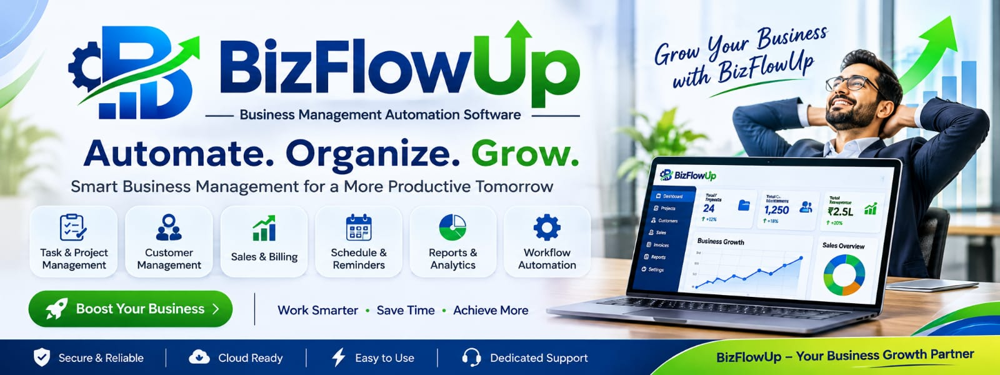

# BIZFLOWUP
### POWERING EVERY BUSINESS.

  

  <strong>A Connected Business Technology Ecosystem</strong>

  We create modern business software that connects operations, simplifies complexity and helps organizations move forward with confidence.

  <a href="https://bizflowup.com">WEBSITE</a>
  &nbsp;&nbsp; | &nbsp;&nbsp;
  <a href="https://github.com/BizFlowUp">GITHUB ORGANIZATION</a>

---

## WHO WE ARE

**BIZFLOWUP** is building an integrated ecosystem of business applications designed to make powerful technology more accessible, connected and adaptable.

Our focus is on developing software that brings essential business functions together — from enterprise operations and customer relationships to workforce management, finance and intelligent automation.

Our vision is simple:

**Make business technology work better for every business.**

## THE BIZFLOW ECOSYSTEM

A unified product family. Designed for connected business operations.

| PRODUCT | DESCRIPTION |
|:---|:---|
| **BIZFLOW ERP** | Enterprise resource planning, operations, inventory and manufacturing management. |
| **BIZFLOW CRM** | Customer relationships, sales pipelines, lead management and engagement. |
| **BIZFLOW HR** | Human resources, employee management and workforce operations. |
| **BIZFLOW Finance** | Financial operations, accounting workflows and business visibility. |
| **BIZFLOW AI** | AI-powered assistance, intelligent workflows and business automation. |

Products and capabilities are under development and may be released progressively.

## OUR TECHNOLOGY PRINCIPLES

| PRINCIPLE | OUR COMMITMENT |
|:---|:---|
| Connected | Bringing business processes and teams into a unified ecosystem. |
| Intelligent | Applying AI and automation to simplify everyday work. |
| Modular | Creating adaptable solutions for different business requirements. |
| Scalable | Building foundations that support long-term growth. |
| Extensible | Enabling integrations and continuous innovation. |

## TECHNOLOGY & BRAND ECOSYSTEM

BIZFLOWUP is part of a broader technology ecosystem supported by distinct engineering and development identities.

<table>
  <tr>
    <td align="center" width="50%">
      
        
      <strong>SUNDIAL LAB</strong>
       
      FRAMEWORKS · ENGINEERING · TECHNOLOGY
        
      <a href="https://github.com/sundial-lab">VISIT GITHUB</a>
    </td>
    <td align="center" width="50%">
      
        
      <strong>BAKEWEB</strong>
       
      DEVELOPMENT · DIGITAL SOLUTIONS · IMPLEMENTATION
        
      <a href="https://github.com/BakeWeb-India">VISIT GITHUB</a>
    </td>
  </tr>
</table>

## ENGINEERING & OPEN SOURCE

We believe sustainable software is built on strong engineering foundations and responsible collaboration.

The BIZFLOWUP organization focuses on:

- BIZFLOW-branded products and applications.
- Custom modules, extensions and integrations.
- Shared developer tools and utilities.
- Product documentation and technical resources.
- AI capabilities and intelligent automation.
- Supporting infrastructure and deployment solutions.

We value open-source technologies and respect the original maintainers, licenses, copyrights and attribution of upstream projects. Original upstream repositories remain maintained outside this organization.

## BUILD WITH US

We welcome developers, technology partners, businesses and open-source contributors who share our interest in building better business software.

Ideas, feedback and meaningful collaboration help make the ecosystem stronger.

## CONNECT

  <a href="https://bizflowup.com">BIZFLOWUP.COM</a>
  &nbsp;&nbsp; | &nbsp;&nbsp;
  <a href="https://github.com/BizFlowUp">GITHUB</a>
  &nbsp;&nbsp; | &nbsp;&nbsp;
  <a href="https://github.com/sundial-lab">SUNDIAL LAB</a>
  &nbsp;&nbsp; | &nbsp;&nbsp;
  <a href="https://github.com/BakeWeb-India">BAKEWEB</a>

---

  <strong>BIZFLOWUP</strong>
   
  <em>Powering Every Business.</em>
    
  Connected technology. Smarter operations. Better possibilities.

